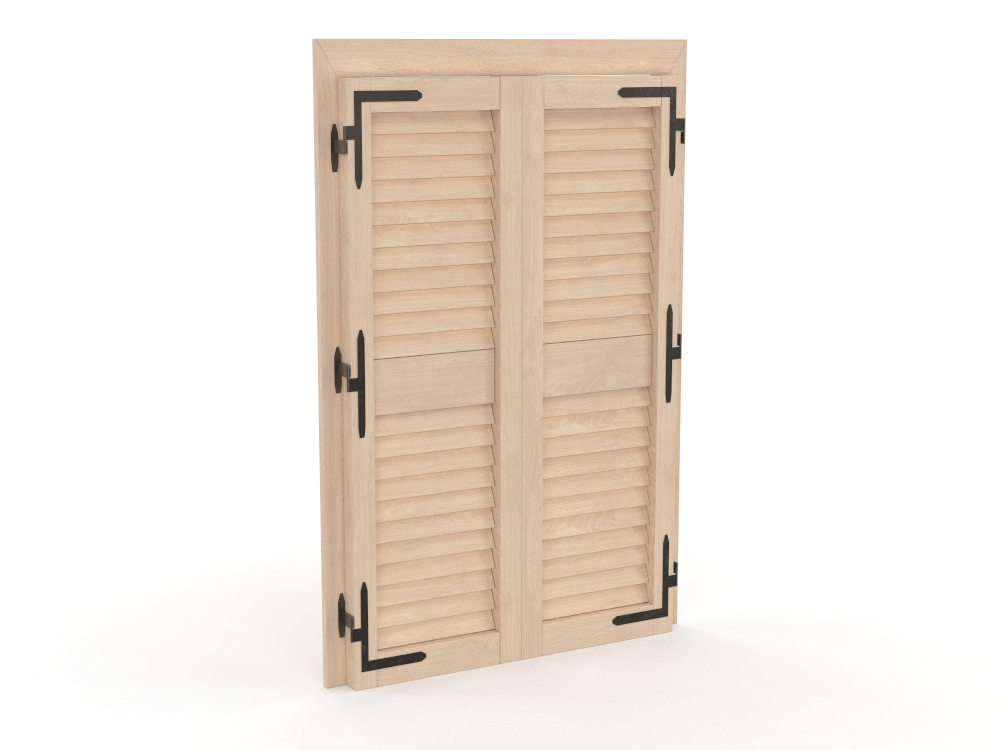

# 3D Modeling Portfolio

3D models created using Autodesk 3ds Max.

## Project 01 — Hinged 2-Leaf Shutter

### Project Description

A detailed 3D model of a hinged two-leaf shutter.

### Available Formats
- FBX
- GLB

### Software
- Autodesk 3ds Max

### Services
- 3D Modeling
- Hard Surface Modeling
- 3D Asset Creation
- 3D Model Optimization
- FBX and GLB Export

### Contact
Available for freelance projects and custom 3D modeling.

---

More projects coming soon.
